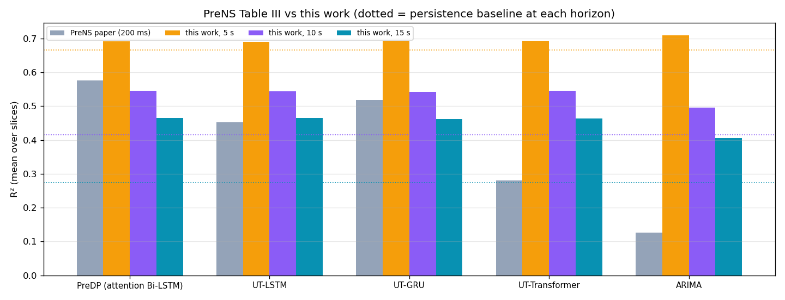

# Predictive Network Slice Management for Private 5G - Traffic Prediction

Final Year Project, University of Moratuwa (Group 17).

This repository holds the **prediction part** of the system. It forecasts how many PRBs each network slice (eMBB, URLLC, mMTC) will **request** 1–15 s ahead, for the **downlink (DL) and uplink (UL) separately**, together with a **confidence** value. Each forecast is sent as an A1 package so the RIC can reserve resources before the demand arrives.

It contains:

1. **A 5G traffic simulator** matched to our testbed. It generates the training dataset (130 h, sampled at 1 s): `data/raw` (DL only) and `data/raw_v2` (DL + UL, DL columns identical). See [PLAN_UL.md](PLAN_UL.md).
2. **PreDP**, the attention Bi-LSTM from the PreNS paper. It ships with UT-LSTM, UT-GRU, UT-Transformer, ARIMA, persistence and moving-average baselines.
3. **Any 3 horizons between 1 and 15 s**, for example 5/10/15, 7/9/12 or 1/3/5. One model predicts every horizon from 1 to 15 s, so changing the horizons needs no retraining.
4. **Confidence calibration.** Confidence comes from the error of recent predictions whose true values are now known.
5. **A web UI (React + FastAPI)** to explore the data, train, evaluate, compare with PreNS and run live inference.



---

## Contents
- [Quick start](#quick-start)
- [Testbed being modelled](#testbed-being-modelled)
- [Repository layout](#repository-layout)
- [1. Dataset (simulator)](#1-dataset-simulator)
- [2. Training](#2-training)
- [3. Evaluation](#3-evaluation)
- [4. Confidence](#4-confidence)
- [5. Inference and A1 packages](#5-inference-and-a1-packages)
- [6. Web UI](#6-web-ui)
- [Results](#results)
- [Experiments](#experiments)
- [Using real testbed data](#using-real-testbed-data)
- [Tests](#tests)

---

## Quick start

```bash
# 1. Python dependencies (install CUDA PyTorch first, from pytorch.org)
pip install -r requirements.txt

# 2. Generate the dataset (130 traces of 1 h; a few minutes on 8+ cores).
#    Skip this if data/raw/ is already in the repo.
python -m datagen.generate --out data/raw

# 3. Train PreDP on all 3 slices, every horizon from 1 to 15 s
python train.py --data data/raw --model predp --horizons 5 10 15 --horizon-mode all \
                --run-name predp_uni_all_5-10-15_full

# 4. Start the UI (builds the React app the first time; needs Node 20+)
./run_ui.sh            # → http://127.0.0.1:8765
```

Every step can also be run from the UI. Trained runs are saved in `runs/`, so the UI works straight away without retraining.

---

## Testbed being modelled

| Parameter | Value |
|---|---|
| Band / bandwidth / SCS | n78, 60 MHz, 30 kHz |
| PRBs | **162** |
| UEs | 9: 3 eMBB, 3 URLLC, 3 mMTC |
| Sampling | **1 s**. Simulated at 100 ms and aggregated as mean, max and p95. |
| Prediction horizons | 3 horizons chosen from **1–15 s** |
| Target | Requested PRBs per slice (`<slice>_req_prb_mean`), not allocated PRBs |

We sample at 1 s instead of PreNS's 100 ms because our horizons are 1–15 s. A 100 ms resolution would only add noise and make the windows 10× larger.

---

## Repository layout

```
configs/sim.yaml          simulator configuration (radio, slices, traffic ranges, scenarios)
configs/testbed_map.yaml  column mapping for testbed KPI imports
templates/                example testbed KPM export (long) and a wide CSV template
datagen/                  traffic simulator
  scenarios.py            Markov scenario scheduler and load-intensity curves
  channel.py              CQI process (AR(1) plus blockage) → spectral efficiency → PRB capacity
  traffic.py              eMBB (ABR video, bulk), URLLC (control, alarms, AGV cycles), mMTC (periodic)
  allocator.py            weighted water-filling PRB allocator with backlog
  simulator.py            simulate one trace (100 ms tick → 1 s rows)
  generate.py             CLI: generate all splits and manifest.json
  check_dataset.py        dataset quality checks and plots (ACF, persistence R², distributions)
  plot_trace.py           plot requested vs allocated PRBs
prep/
  data.py                 load splits, causal median filter, min-max scaler (fitted on train only)
  testbed.py              import testbed KPI exports (E2 KPM) into the dataset format
  windows.py              sliding windows that never cross trace boundaries (GPU-backed WindowSet)
models/
  predp.py                PreDP attention Bi-LSTM and build_model()
  baselines.py            UT-LSTM / UT-GRU / UT-Transformer
  metrics.py              RMSE / MAE / R²
train.py                  train one run (one model per slice); also calibrates confidence
evaluate.py               compare runs with persistence, MA-10 and ARIMA on the test, val or OOD split
confidence.py             calibrate confidence from rolling matured RMSE
predictor.py              load a run and predict any horizons with confidence
infer.py                  CLI: emit A1 prediction packages (JSON Lines)
experiments/
  grid_search.py          hidden × learning-rate grid
  run_queue.py            run experiment sets E1–E15
  prens_comparison.py     build the comparison with PreNS Table III
api/                      FastAPI backend (server.py, background jobs in jobs.py)
ui/                       React 19 + Vite + TypeScript + Tailwind + Recharts front end
run_ui.sh                 build the UI if needed and start the server
data/raw/                 generated dataset (parquet traces, plus a json of scenario segments per trace)
runs/                     trained runs (models, scaler, config, metrics, confidence)
reports/                  dataset checks, evaluations, PreNS comparison
tests/                    pytest unit tests
PLAN.md                   full project plan and experiment design
```

---

## 1. Dataset (simulator)

The simulator reproduces the testbed cell at a **100 ms tick** and writes **1 s rows**.

- **Scenarios.** A Markov scheduler switches between 7 scenarios: `stable`, `ramp_up`, `ramp_down`, `burst`, `ue_churn`, `contention` and `sla_conflict`. Each scenario shapes a per-slice load-intensity curve.
- **Traffic per slice:**
  - eMBB: adaptive-bitrate video whose level follows the load intensity, plus bulk transfers.
  - URLLC: periodic control traffic, sustained alarm mode during bursts, AGV duty cycles, and short bursts.
  - mMTC: periodic sensor reports.
- **Channel.** CQI follows an AR(1) process with blockage drops. It maps to spectral efficiency using 3GPP TS 38.214 Table 5.2.2.1-2, and from there to PRB capacity:
  `capacity = 168 RE × (1 − 0.14) × 2000 slots/s × SE × 0.7 (DL) × se_scale`.
- **Allocation.** A weighted water-filling allocator respects each slice's min/max PRB limits. Demand that can't be served is carried in a capped backlog.
- **Domain randomisation.** Every 1 h trace draws its own traffic parameters from the ranges in `configs/sim.yaml`. The **OOD** profile uses wider ranges that the model never sees in training.

| Split | Traces | Hours | Profile |
|---|---|---|---|
| train | 84 | 84 | in-distribution |
| val | 18 | 18 | in-distribution |
| test | 18 | 18 | in-distribution, unseen traces |
| ood | 10 | 10 | out-of-distribution |

The dataset has 468k rows and 34 columns, about 56 MB. Splits are **by trace**, so no window ever crosses a trace boundary or a split.

```bash
python -m datagen.generate --out data/raw                    # everything (fixed base seed, reproducible)
python -m datagen.generate --out data/small --only train:2,test:1
python -m datagen.check_dataset --data data/raw --out reports/dataset
python -m datagen.plot_trace --trace test_000 --start 9 --minutes 5
```

Each trace has these per-slice columns: `req_prb_{mean,max,p95}`, `alloc_prb_mean`, `tput_mbps`, `backlog`, `cqi_mean`, `active_ue` and `latency_ms`. There are also `t` and `scenario` columns.

The dataset checks all pass. Persistence R² at 5/10/15 s:

| | 5 s | 10 s | 15 s |
|---|---|---|---|
| eMBB | 0.79 | 0.60 | 0.44 |
| URLLC | 0.47 | 0.06 | −0.14 |
| mMTC | 0.73 | 0.59 | 0.52 |

The data is predictable, but not trivially: simply repeating the last value gets much worse as the horizon grows.

---

## 2. Training

```bash
python train.py --data data/raw \
    --model predp            # predp | lstm | gru | transformer
    --horizons 5 10 15       # any H1 < H2 < H3 within 1..15
    --horizon-mode all       # all = outputs for 1..15 s (serve any horizons later) | dedicated = 3 outputs only
    --features uni           # uni = target history only | multi = also CQI, active UEs, backlog, ...
    --target point           # point = demand at t+h (PreNS) | mean / max = average / peak demand over (t, t+h]
    --loss mse               # mse | quantile (with --quantile 0.9: predict the 90th percentile = safe side)
    --target-mode level      # level | residual (predict the change from the last value; E9)
    --lookback 30            # input window, in seconds
    --hidden 64 --lr 1e-3 --batch-size 32 \
    --max-epochs 200 --patience 20 \
    --run-name my_run
```

- **Preprocessing.**
  - Gaps of up to 2 s are interpolated.
  - A causal (trailing) median filter of size 3 is applied to the **inputs only**; targets stay raw.
  - The min-max scaler is fitted on train only.
- **PreDP** is a Bi-LSTM with 64 hidden units per direction, additive attention over time, then a dense head. Each slice gets its own model.
- **Training.**
  - Adam, MSE loss, early stopping on validation loss.
  - All windows are gathered on the GPU, so an epoch over 84 h of data takes seconds.
- **Output.** Each run writes `runs/<run-name>/`:
  - `model_<slice>.pt`, `config.json`, `scaler.json` and `train_log.json`
  - `metrics.json`: test metrics compared with persistence, plus parameters, training time, inference latency and peak GPU memory
  - `confidence.json`: calibrated automatically after training

---

## 3. Evaluation

```bash
python evaluate.py --runs predp_uni_all_5-10-15_full E1/lstm_uni_all_s0 E1/gru_uni_all_s0 \
                   --split test --horizons 5 10 15 --arima-n 2000 --tag my_eval
python experiments/prens_comparison.py      # → reports/prens_comparison/
```

`evaluate.py` compares every run with **persistence**, **MA-10** and **ARIMA(2,0,1)**. Two optional combined methods:
- `--ensemble` adds the average of the given runs.
- `--blend` adds `w·ensemble + (1−w)·persistence`. The weight `w` is fitted per slice and horizon on the **validation** split, so the model leans on persistence at 1–3 s, where persistence is hard to beat, and on the deep model at 10–15 s.

All runs being compared must predict the same target (`point`, `mean` or `max`). ARIMA runs on a random subset of windows, and every method is also scored on that same subset. It writes `reports/eval/<tag>/`:
- `results.json`
- `table.md`: RMSE, MAE, R² and skill over persistence per slice and horizon
- RMSE per scenario
- plots

---

## 4. Confidence

Each prediction carries a confidence value **C ∈ (0, 1]**.

1. At time *t*, take the predictions for this slice and horizon that have **matured**, meaning they were made at t′ ≤ t − h, so their true value is now known.
2. Compute the RMSE of the last 30 of them.
3. Convert it to confidence: `C = 2^(−rmse / τ)`, where τ is the median rolling RMSE on the validation split.

So C = 0.5 means the recent error equals a typical error. C rises towards 1 when the model has been more accurate than usual, and falls towards 0 when it has been less accurate. Until enough predictions have matured, the validation RMSE is used instead. Calibration plots (`runs/<id>/confidence_calibration.png`) show that higher C goes with lower actual error.

```bash
python confidence.py --run predp_uni_all_5-10-15_full     # recalibrate an existing run
```

---

## 5. Inference and A1 packages

Each package is one record per slice, horizon and prediction time. This matches P_i = (D̂, C, T) in the feasibility report:

```json
{"t_pred": 1712, "slice": "urllc", "horizon_s": 7, "target_time": 1719,
 "pred_prb": 23.4, "confidence": 0.63, "run_id": "predp_uni_all_5-10-15_full"}
```

```bash
# predict on a simulated test trace
python infer.py --run predp_uni_all_5-10-15_full --h 7 9 12 --trace test_000 --start 600 --seconds 60

# predict on your own 1 s KPI file (CSV or Parquet with the same column names), write JSON Lines
python infer.py --run predp_uni_all_5-10-15_full --h 5 10 15 --file my_testbed_kpis.csv --out a1.jsonl
```

From Python:

```python
from predictor import Predictor
P = Predictor("runs/predp_uni_all_5-10-15_full")
preds = P.predict_df(df, horizons=[7, 9, 12])     # requested PRBs, clipped at ≥ 0
```

---

## 6. Web UI

```bash
./run_ui.sh            # build if needed, then serve on http://127.0.0.1:8765
./run_ui.sh --build    # force a rebuild after changing ui/src
```

| Page | What it does |
|---|---|
| **Overview** | Datasets, runs, the best results and running jobs |
| **Dataset** | Quality checks, ACF and persistence charts, a trace viewer with scenario shading, generating new datasets |
| **Train** | Choose the model, features, slices and **3 horizons (1–15 s)**, then train with a live loss chart and see the results |
| **Evaluate** | Compare runs with the baselines. The **PreNS paper comparison** tab shows accuracy, same-window R², ranking, per-slice results and cost. |
| **Inference** | Forecast with confidence for any horizons, replay a trace in real time, upload your own KPI file, export A1 JSON Lines |

For development with hot reload, run the backend and the Vite dev server in two terminals. Vite proxies `/api` to port 8765:

```bash
python3 -m uvicorn api.server:app --host 127.0.0.1 --port 8765 --reload
cd ui && npm install && npm run dev        # → http://localhost:5173
```

The API is listed at http://127.0.0.1:8765/docs. Port 8765 is used because 8000 is taken on the development machine. Change it in `run_ui.sh` and `ui/vite.config.ts` if you need to.

---

## Results

Test split: 18 unseen 1 h traces, 64,008 windows. Values are the mean R² of the 3 slices.

### Final models (deployment)
| Direction | Run | Inputs per slice | UI default |
|---|---|---|---|
| **DL** | `FINAL/predp_dl_point_v3` | eMBB: own DL history, **quantile 0.55 loss** (E16) · **URLLC: DL + UL history** (E14) · mMTC: own DL history | `runs/DEFAULT_RUN` |
| **UL** | `FINAL/predp_ul_point_v3` | eMBB: own UL history, **quantile 0.60 loss** (E16) · URLLC, mMTC: own UL history | `runs/DEFAULT_RUN_UL` |

**v3 (E16): eMBB beats persistence on MAE *and* under-reserves less.** The median-loss v2 passed the lab rule but was biased low on skewed eMBB demand: its shortfall (mean PRBs below actual demand) was higher than persistence's. E16 swept q = 0.55 / 0.60 / 0.65 with a selection rule registered before training (`reports/eval/E16_selection/RULE.md`): pass the lab rule at 5–12 s **and** have a shortfall ≤ persistence at 5 / 8 / 12 s; take the lowest such q; confirm with 3 seeds. Result: **DL q = 0.55, UL q = 0.60**, all 3 seeds qualify (`reports/eval/E16_selection/confirmation.md`).

| eMBB shortfall (PRB) @5 / 8 / 12 s | DL | UL |
|---|---|---|
| v1 (MSE) | 5.98 / 7.46 / 8.91 | 2.91 / 3.52 / 4.19 |
| v2 (median) | 6.26 / 8.07 / 10.38 | 3.11 / 3.97 / 4.47 |
| **v3 (q 0.55 / 0.60)** | **5.48 / 6.97 / 9.18** | **2.36 / 3.21 / 3.67** |
| persistence | 5.94 / 7.69 / 9.36 | 2.94 / 3.59 / 4.20 |

With v3 the lab rule passes at **5–12 s in all 6 slice/direction groups** (`reports/eval/rule_check_final_v3.json`). eMBB UL passes narrowly at 5–6 s (10 of 18 traces won) and clearly from 7 s. 4 s is excluded for timing anyway. v2 is kept as `FINAL/predp_*_point_v2`.

<details><summary>v2 (E15) note</summary>

**v2 (E15): eMBB uses a median (MAE) loss.** The lab's horizon rule scores pooled MAE, p95 error and traces won against persistence (`experiments/horizon_rule_check.py`). MSE-trained eMBB models learn the *mean*, which beats persistence on RMSE but not on MAE, because eMBB demand jumps between levels. With `--loss quantile --quantile 0.5`, eMBB beats persistence on MAE at every horizon (DL 0.988 → 0.955, UL 0.970 → 0.939 of persistence MAE; 16–18 of 18 val traces won; 3 seeds agree). **All horizons 4–12 s now pass the rule in all 6 slice/direction groups** (`reports/eval/rule_check_final_v2.json`). The v1 models (`FINAL/predp_dl_point`, `E13/predp_ul_point_s0`) failed it on eMBB.
</details>

All use PreDP without the median filter, a 60 s input and 1–15 s outputs, on `data/raw_v2`. `FINAL/predp_dl_point` is composed (`experiments/compose_run.py`) from `E12/predp_final_point_s0` (eMBB, mMTC) and `E14/predp_dl_pair_s0` (URLLC). It needs **UL measurements as input** for URLLC; if UL data is unavailable, use `E12/predp_final_point_s0` (DL only).

Peak-target models (busiest second in the next h s): `E12/predp_final_max_s0` (DL), `E13/predp_ul_max_s0` (UL), and the safe-side `E13/predp_ul_max_q90_s0`.

| Final model, mean R² (same 2000 windows as ARIMA) | @5 s | @10 s | @15 s |
|---|---|---|---|
| **DL final** (`FINAL/predp_dl_point`) | **0.739** | **0.596** | **0.511** |
| DL, own history only | 0.724 | 0.571 | 0.491 |
| DL ARIMA / persistence | 0.701 / 0.673 | 0.508 / 0.426 | 0.421 / 0.290 |
| **UL final** (`E13/predp_ul_point_s0`) | **0.791** | **0.618** | **0.534** |
| UL ARIMA / persistence | 0.786 / 0.768 | 0.599 / 0.547 | 0.505 / 0.418 |
| **UL peak** (`E13/predp_ul_max_s0`) | **0.885** | **0.800** | **0.748** |
| UL peak ARIMA / persistence | 0.847 / 0.843 | 0.702 / 0.687 | 0.593 / 0.564 |

URLLC DL gains most from the UL history: R² 0.611 / 0.426 / 0.327 vs 0.564 / 0.347 / 0.261 with DL history only.

### PreNS comparison model (DL, own history only)
`runs/E12/predp_final_point_s0` is PreDP **without the median filter and with a 60 s input**, the best settings from E4 and E5, using each slice's own DL history only (like PreNS). It is the model in the PreNS comparison.

| Model | PreNS R² (200 ms) | @1 s | @5 s | @10 s | @15 s |
|---|---|---|---|---|---|
| **PreDP final** | 0.576 | **0.950** | **0.726** | **0.566** | **0.481** |
| PreDP, original settings | 0.576 | 0.904 | 0.692 | 0.545 | 0.465 |
| ARIMA(2,0,1)* | 0.126 | 0.951 | 0.701 | 0.508 | 0.421 |
| Persistence | — | 0.947 | 0.673 | 0.426 | 0.290 |

\*ARIMA is scored on 2000 random windows (1000 at 1 s). The other rows at 5–15 s are on those same windows.

On the **peak demand over the next h s** target (`E12/predp_final_max_s0`), the final model scores **0.851 / 0.766 / 0.708** at 5 / 10 / 15 s. ARIMA scores 0.808 / 0.657 / 0.542 and persistence 0.802 / 0.631 / 0.484.

### PreNS models (Table III), 3 training seeds each
| Model | PreNS R² (200 ms) | Our R² @5 s | @10 s | @15 s |
|---|---|---|---|---|
| PreDP (attention Bi-LSTM) | 0.576 | 0.692 ± 0.001 | 0.545 ± 0.001 | 0.465 ± 0.001 |
| UT-LSTM | 0.452 | 0.691 ± 0.001 | 0.545 ± 0.001 | 0.465 ± 0.001 |
| UT-GRU | 0.518 | 0.691 ± 0.002 | 0.545 ± 0.003 | 0.464 ± 0.004 |
| UT-Transformer | 0.281 | 0.692 ± 0.001 | 0.546 ± 0.000 | 0.463 ± 0.001 |

### What the results show
- **The architecture doesn't matter on this data.** The four deep models are within the seed-to-seed spread. PreNS reports a clear lead for PreDP; we can't confirm it. The grid search agrees: the hidden size and learning rate barely change the results.
- **Preprocessing and input length do matter.** Removing the median filter (E5) is the largest single gain. The filter delayed the input by about 1 s, and without it the model beats persistence even at 1 s. A 60 s input (E4) adds a little more.
- **The final model beats ARIMA and persistence at every horizon from 5 to 15 s.** At 1–3 s, persistence and ARIMA are about as good, so predicting adds little there.
- **What you predict matters more than the model.** Predicting the *peak* over the next h s gives R² 0.71 at 15 s, compared with 0.48 for the demand at exactly t+h. It's also what PRB reservation needs.
- **Safe-side URLLC forecasts** (E11, 90th percentile) cut under-prediction from about 80% (reactive) to 12%. The average shortfall drops from 8–11 to 1–1.6 PRBs, at the cost of reserving about 12–18 extra PRBs.
- **Extra KPIs as inputs (E3) overfit.** They help slightly on normal traffic and hurt badly out of distribution. **More data (E8)** brings little beyond 25–50 h.
- **One `all`-horizons model matches dedicated 3-horizon models** (E2), so the UI can switch horizons without retraining.
- **Uplink is as predictable as downlink** (E13), and its peaks even slightly more. Separate UL models beat ARIMA and persistence. UL is spikier (higher CV and skew, especially mMTC telemetry).
- **DL and UL help each other only for URLLC** (E14): UL status and alarm reports announce DL command bursts, so the UL history improves URLLC DL forecasts. For eMBB and mMTC, separate models are best.
- **Limitation: traffic outside the training range** (E6). With long URLLC bursts and higher load, persistence beats the model. Testbed fine-tuning (E7) is needed before deployment.

The full comparison (RMSE/MAE in z-units, per-slice results, cost) is in [`reports/prens_comparison/comparison.md`](reports/prens_comparison/comparison.md) and in the UI under **Evaluate → PreNS paper comparison**.

> **Cost.** PreDP takes 27 min to train on 84 h of data (3 slice models, RTX 4060 Laptop, GPU not shared) and 0.115 ms per prediction. PreNS reports 10.6 min and 0.467 ms on an RTX 4090.

---

## Experiments

Run with `python experiments/run_queue.py --exp E1 E3 --seeds 0 1 2 --parallel 2`. The queue skips runs that have already finished.

| ID | Question | Runs | Status |
|---|---|---|---|
| E1 | PreDP vs UT-LSTM / UT-GRU / UT-Transformer / ARIMA (the PreNS table) | `runs/E1/` | ✅ 3 seeds: the models are tied |
| E2 | Does one `all`-horizons model match dedicated models? | `runs/E2/` | ✅ yes |
| E3 | Do extra features (CQI, active UEs, backlog) help? | `runs/E3/` | ✅ +0.006 R² on test, but **−0.09 to −0.14 R² out of distribution**. Not used. |
| E4 | Lookback of 20 s or 60 s instead of 30 s | `runs/E4/` | ✅ 60 s: +0.005–0.008 R². 20 s: slightly worse. |
| E5 | Effect of turning off the median filter | `runs/E5/` | ✅ **Best single gain**: +0.031 R² at 5 s, and it now beats persistence at 1 s (0.950 vs 0.947). |
| E6 | Out-of-distribution test (`evaluate.py --split ood`) | `reports/eval/E6_ood_ood/` | ✅ weakness found (below) |
| E7 | Fine-tuning on real testbed data (`train.py --init-from`) | — | needs testbed traces |
| E8 | Learning curve: 10 / 25 / 50 h of training data | `runs/E8/` | ✅ 10 h: 0.680, 25 h: 0.686, 50 h: 0.690, 84 h: 0.692 R² at 5 s. More data barely helps. |
| E9 | Level-invariant target (`--target-mode residual`): predicts the change from the last value | `runs/E9/` | ✅ OOD better (+0.04 R² at 5 s, URLLC +0.09), but test worse (−0.007 / −0.020 / −0.032). Not used. |
| E10 | Reservation targets: **average** and **peak** demand over the next h s (`--target mean/max`) | `runs/E10/` | ✅ **Peak:** R² 0.81/0.73/0.68, beats ARIMA (0.82/0.69/0.57) at 10–15 s. **Average:** R² 0.83/0.76/0.72, but ARIMA is as good or better. |
| E11 | Safe-side forecasts: 90th percentile (`--loss quantile`), for the point and peak targets | `runs/E11/` | ✅ URLLC under-prediction drops to 12% (reactive: 72–85%); shortfall 1–1.6 PRBs |
| E12 | **Final candidates**: no median filter + 60 s lookback, for the point and peak targets | `runs/E12/` | ✅ **PreNS-comparison final**: 0.726 / 0.566 / 0.481 (point), 0.851 / 0.766 / 0.708 (peak) |
| E13 | **Uplink models** (`data/raw_v2`, `--direction ul`): point, peak, q90, peak-q90 | `runs/E13/` | ✅ point 0.791 / 0.618 / 0.534 and peak 0.885 / 0.800 / 0.748, both above ARIMA (mMTC UL point: tied with ARIMA). Peak-q90 cuts URLLC UL under-prediction to 11–12%. |
| E16 | **eMBB quantile sweep** q = 0.55 / 0.60 / 0.65, pre-registered rule, 3-seed confirmation | `runs/E16/`, `reports/eval/E16_selection/` | ✅ DL q = 0.55, UL q = 0.60: pass the lab rule **and** shortfall ≤ persistence; q = 0.65 fails MAE. **v3 final models** |
| E15 | **eMBB median (MAE) loss**, DL and UL, 3 seeds | `runs/E15/` | ✅ passes the lab horizon rule at 4–12 s in every seed (MSE models failed on eMBB); RMSE stays below persistence |
| E14 | **1 or 2 models per slice?** `uni` (own direction) vs `pair` (DL + UL history), 3 seeds | `runs/E14/`, `reports/eval/E14_decision/` | ✅ eMBB and mMTC: 2 separate models. **URLLC DL: pair** (+2.7 to +4.0% skill, OOD equal). URLLC UL: separate; pair gains only +1% on test and is worse on OOD in every seed. |

The whole remaining set runs overnight with `experiments/run_remaining.sh`, which logs to `runs/_logs/remaining.log`.

**E6 result:** on the OOD traces PreDP is worse than persistence for eMBB and URLLC. For URLLC the RMSE skill is −41 % at 5 s and −12 % at 15 s; mMTC still wins at 10–15 s. In the OOD profile:
- URLLC bursts last 10–25 s, and 40 % of the time is spent in burst, contention or sla_conflict (23 % in training).
- URLLC lag-5 autocorrelation is 0.89, compared with 0.70 in training.
- Average URLLC demand is 2.6× higher.

The model has learned that bursts end quickly, so it predicts a drop that doesn't happen. Wider training variety or fine-tuning on testbed data (E7) is therefore needed before deployment. E9 targets the level-shift part of the problem.
| grid | Hidden × learning rate on URLLC | `runs/grid/` | ✅ |

---

## Using real testbed data

`prep/testbed.py` converts a testbed KPI export into the same dataset format as `data/raw/`. The output can then be used for evaluation, fine-tuning and the UI.

1. Collect E2 KPM reports with a **1000 ms report period**. Log the PRB **demand** per slice (buffer-based), not only the PRBs used. If you can, also log the traffic scenario you ran.
2. Point [`configs/testbed_map.yaml`](configs/testbed_map.yaml) at your column names. It accepts both layouts:
   - **long:** one row per time and slice (SST 1/2/3), like [`templates/testbed_kpm_long_example.csv`](templates/testbed_kpm_long_example.csv)
   - **wide:** one row per time, like [`templates/testbed_wide_template.csv`](templates/testbed_wide_template.csv)
3. Import:
   ```bash
   python -m prep.testbed --input my_kpm.csv --map configs/testbed_map.yaml --name day1
   # → data/testbed/day1/  (1 s rows, cut at gaps > 30 s, 10 min traces, chronological 70/15/15 split)
   ```
   - Timestamps are rounded to the nearest second, so report jitter doesn't matter.
   - Gaps of 2 s or less are interpolated later.
   - KPIs missing from the file are filled from the demand column and listed in `manifest.json`.
4. Use it:
   ```bash
   # how does the simulator-trained model do on real data?
   python evaluate.py --data data/testbed/day1 --runs predp_uni_all_5-10-15_full --split test --arima-n 500
   # E7: fine-tune from the simulator model (same scaler and architecture, low learning rate)
   python train.py --data data/testbed/day1 --init-from runs/predp_uni_all_5-10-15_full \
                   --lr 1e-4 --patience 10 --run-name E7/predp_finetune_day1
   ```
   The imported dataset also appears in the UI (Dataset and Train pages). You can upload a single file for inference on the **Inference** page.

Still to do on the testbed: calibrate `se_scale` in `configs/sim.yaml` with iperf3 tests per slice.

---

## Tests

```bash
python -m pytest tests -q        # windowing, scaler, no leakage across traces, confidence maturity
```

---

## Reference

PreNS: Wu et al., *"PreNS: A Hybrid Predictive and Real-Time ..."*, IEEE Transactions on Cognitive Communications and Networking, 2026. We reproduce its PreDP model and baselines (Table III) at our testbed's time scale.
